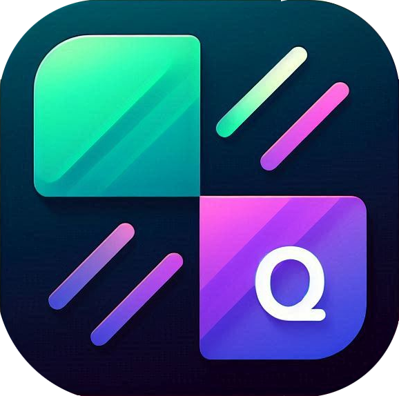

<div style="text-align: center;">

[](https://gitlab.com/flxholle/quick-tiles/-/releases)
[](https://gitlab.com/flxholle/quick-tiles/-/graphs/master)
[](https://gitlab.com/flxholle/quick-tiles/-/forks)
[](https://gitlab.com/flxholle/quick-tiles/-/starrers)
[](https://gitlab.com/flxholle/quick-tiles/-/issues)
[](https://gitlab.com/flxholle/quick-tiles/-/blob/master/LICENSE.txt)

[#top]

</div>


<br />
<div align="center">


<h3 align="center">QuickTiles</h3>

<p align="center">
    Add custom quick settings tiles to your Android device.
    <br />
    <a href="#about-the-project">View Project</a>
    &middot;
    <a href="https://gitlab.com/flxholle/quick-tiles/-/issues/new?issue%5Bissue_type%5D=issue">Report Bug</a>
    &middot;
    <a href="https://gitlab.com/flxholle/quick-tiles/-/issues/new?issue%5Bissue_type%5D=enhancement">Request Feature</a>
  </p>

</div>

<details>
  <summary>Table of Contents</summary>
  <ol>
    <li><a href="#about-the-project">About The Project</a>
      <ul>
        <li><a href="#features">Features</a></li>
        <li><a href="#built-with">Built With</a></li>
      </ul>
    </li>
    <li><a href="#usage">Usage</a></li>
    <li><a href="#troubleshooting-on-android-16--17-and-aggressive-oem-builds">Troubleshooting on Android 16 / 17</a></li>
    <li><a href="#google-play-protect-warning">Google Play Protect Warning</a></li>
    <li><a href="#building-a-debug-apk-with-github-actions">Building a debug APK (GitHub Actions)</a></li>
    <li><a href="#building-for-android-17-api-37">Building for Android 17</a></li>
    <li><a href="#contributing">Contributing</a>
      <ul>
        <li><a href="#prerequisites">Prerequisites</a></li>
        <li><a href="#installation">Installation</a></li>
        <li><a href="#how-to-contribute">How to Contribute</a></li>
      </ul>
    </li>
    <li><a href="#roadmap">Roadmap</a></li>
    <li><a href="#license">License</a></li>
    <li><a href="#contact">Contact</a></li>
    <li><a href="#acknowledgments">Acknowledgments</a></li>
  </ol>
</details>

## About The Project
QuickTiles lets you add custom quick settings tiles to your Android device, enabling fast access to
your favorite actions and shortcuts. The app is open source and privacy-friendly.


### Download

[](https://f-droid.org/packages/com.asdoi.quicktiles/)
[](https://gitlab.com/flxholle/quick-tiles/-/releases)


<div align="right">(<a href="#top">back to top</a>)</div>

### Features ✨

- 🎵 Media control (play/pause, next, previous, media volume)
- 🔊 Show volume panel
- 📅 New event/alarm/timer
- 📞 Make call
- 📷 Take photo/record video
- 🧮 Open calculator/file manager
- 📱 Open custom apps
- 🔍 Search settings
- 🌐 Open languages
- 📖 Open dictionary/privacy
- 🔗 Open VPN/data usage/screen cast/connected devices/about
- ⏲️ Set screen timeout
- 🔔 Switch volume modes (normal, vibrate, priority only, alarms only, total silence)
- 💡 Adjust brightness
- 🌙 Adaptive brightness toggle
- 🌑 Grayscale
- 📸 Take screenshot
- 🔄 Force rotation (0°, 90°, 180°, 270°)
- 🔒 Lock screen
- 🖥️ Split screen
- 📳 Set vibration on calls
- ⚡ Open power menu
- 🔋 Show battery level
- 🔢 Counter
- 🐞 Enable/disable USB debugging
- 🕹️ Enable/Disable demo mode
- 🛠️ Open developer options
- 🌙 Enable/Disable keep screen on
- 🏃 Set animator duration scale
- 🚫 Disable all animations
- 🏁 Always finish activities

<div align="right">(<a href="#top">back to top</a>)</div>

### Built With

* 
* 
* 
* 

<div align="right">(<a href="#top">back to top</a>)</div>

## Usage

After installing, open QuickTiles and enable the tiles you want to use. You can then access them
from the quick settings panel on your Android device.

<div align="right">(<a href="#top">back to top</a>)</div>

## Troubleshooting on Android 16 / 17 (and aggressive OEM builds)

Tiles have to be able to run **without the app being open**. A `TileService` is created by the
system on demand and destroyed again as soon as the Quick Settings panel is closed, so the app is
*not* supposed to stay running in the background. Version 1.9 reworked the tile services so that
they no longer depend on any in-memory state, which is what previously made all tiles stop working
after the app was closed (swiped away from the recent apps).

If a tile still shows no reaction:

* Make sure the tile is enabled in the app (that is what enables the tile service component).
* Do **not** "force stop" the app. A force-stopped app may not start any of its components until it
  is launched again - that is a documented Android behaviour and no app can work around it.
* Remove the battery optimization / "deep sleep" restriction for QuickTiles. On Xiaomi/HyperOS,
  OPPO/realme, vivo, OnePlus and Samsung builds the app also has to be allowed to autostart.
* Tiles that write secure settings (USB debugging, animations, show taps, ...) need the
  `WRITE_SECURE_SETTINGS` permission, tiles that change screen timeout or brightness need
  "Modify system settings". If one of those permissions is missing, tapping the tile opens a
  dialog with the exact `adb` command instead of doing nothing.
* The screenshot / lock screen / split screen / power dialog tiles require the QuickTiles
  accessibility service to be enabled in the system accessibility settings.

### Volume panel tile

The volume panel tile shows the short media volume slider - the same one that appears when you
press a volume key - even when QuickTiles is not running in the background. It needs a transparent
activity for that, because SystemUI ignores `AudioManager.FLAG_SHOW_UI` requests coming from an app
that is not in the foreground.

If you prefer the big panel with every stream (media, ring, notification, alarm, call), enable
**Miscellaneous → Expanded volume panel**.

### Tile diagnostics

Version 1.9.1 records what actually happens when a tile is tapped. Open the app, go to
**Settings → Troubleshooting → Tile diagnostics**. The list is ordered newest first and contains
one line per event, for example:

```
11-01 14:32:10.123  GrayscaleTileService onClick
11-01 14:32:09.002  GrayscaleTileService onStartListening
11-01 14:31:58.400  --- app process started (pid 12345) ---
```

The same lines are written to logcat with the tag `QuickTiles`
(`adb logcat -s QuickTiles AndroidRuntime`).

How to read it:

* **Every tap adds an `onClick` line** - the app was reached, so the problem is inside the tile
  (a missing permission, an unsupported setting, ...). A failed tap also shows a short toast with
  the exception.
* **No new lines at all, not even `onBind`/`onStartListening`** - the system never bound the tile
  service. In that case the app was force-stopped or blocked by the system/battery manager, and
  only the system side can be changed (see the list above).
* **Only `onBind` appears, `onStartListening` not** (or the tile appears greyed out in the panel) -
  the tile component is disabled. Re-enable the tile in the app.

The dialog has a **Share** button - the text can be copied and pasted into a bug report.

<div align="right">(<a href="#top">back to top</a>)</div>

## Building a debug APK with GitHub Actions

`.github/workflows/build-debug-apk.yml` builds an installable debug APK for you - no local
Android Studio or SDK needed.

* **Every push to any branch** builds the APK.
* **Download:** GitHub ▸ *Actions* ▸ *Build debug APK* ▸ pick the newest run ▸ *Artifacts* ▸
  `quicktiles-debug-apk` (a zip that contains `quicktiles-<version>-debug.apk`).
* **Pushing a tag** like `v1.9` builds the APK and attaches it to a GitHub release, so it can be
  downloaded directly on the phone:
  `git tag v1.9 && git push origin v1.9`
* **Manual run:** *Actions* ▸ *Build debug APK* ▸ *Run workflow*, optionally with
  "Also attach the APK to a GitHub release" enabled. The "Run workflow" button only shows up once
  this workflow exists on the repository's default branch (the push trigger works right away).

The workflow caches the debug keystore, so successive CI builds share one signature and can be
installed over each other. It is still a debug key, so it cannot be installed over a release build
from F-Droid/Play - uninstall that first (only once). After installing, re-enable your tiles in
the app and re-grant the adb permissions:

```bash
adb shell pm grant com.asdoi.quicktiles android.permission.WRITE_SECURE_SETTINGS
```

<div align="right">(<a href="#top">back to top</a>)</div>

## Building for Android 17 (API 37)

The app currently compiles and targets **API 36 (Android 16)** with AGP 8.13 / Gradle 8.13, which
is the newest combination that the project's toolchain supports out of the box. Apps built against
API 36 run on Android 17 without restrictions, and none of the Android 17 behaviour changes affect
QuickTiles.

Compiling against API 37 requires a newer toolchain (API 37 has a hard floor of AGP 9.1.1), i.e.:

* Android Gradle Plugin `9.1.1` (or newer) in `gradle/libs.versions.toml`
* Gradle `9.3.1` (or newer) in `gradle/wrapper/gradle-wrapper.properties`
* `compileSdk = 37`, `targetSdk = 37` in `app/build.gradle.kts`
* `android.builtInKotlin=false` in `gradle.properties` while the classic Kotlin plugin is used

<div align="right">(<a href="#top">back to top</a>)</div>

## Google Play Protect Warning

**Important:**
Google Play Protect may warn that QuickTiles is a "harmful app."
This is a false positive. You can check the full source code in this repository — there is no
malicious activity.

If you disable Play Protect, Android may still periodically show warnings. This seems to be because
Android stores previously detected warnings and repeats them, even after Play Protect is turned off.

<div align="right">(<a href="#top">back to top</a>)</div>

## Contributing

Contributions make open source amazing. If you have an idea or fix, please:

### Prerequisites

- Android Studio
- Android device or emulator

### Installation

1. Clone the repo

```sh
   git clone https://gitlab.com/flxholle/quick-tiles.git
```

2. Open the project in Android Studio.
3. Build and run the app on your device.

### How to Contribute

1. Fork the Project
2. Create a new branch (`git checkout -b feature/AmazingFeature`)
3. Commit changes (`git commit -m 'Add some AmazingFeature'`)
4. Push to the branch (`git push origin feature/AmazingFeature`)
5. Open a Pull Request

<div align="right">(<a href="#top">back to top</a>)</div>

## Roadmap

- Add customizations to "Demo Mode"
  from [Dev-QuickSettings (feature/settings)](https://github.com/adriangl/Dev-QuickSettings/tree/feature/settings)
- Add JobServices to check if the system settings were manually changed by the user
- Fix the delay after a tile is pressed

## License

Distributed under the GPLv3 License. See `LICENSE` for details.

<div align="right">(<a href="#top">back to top</a>)</div>

## Contact

Felix Hollederer - [@flxholle](https://gitlab.com/flxholle) - flxholle@posteo.com

Project
Link: [https://gitlab.com/flxholle/quick-tiles](https://gitlab.com/flxholle/quick-tiles)

<div align="right">(<a href="#top">back to top</a>)</div>

## Acknowledgments

### Icons

- Old App icon by [Freepik](https://www.flaticon.com/authors/freepik)
  from [Flaticon](https://www.flaticon.com/)
- New App Icon generated with DALL-E 3
  ([OpenAI](https://openai.com/dall-e-3/))
- Toggle-split-screen icon by [Smashicons](https://www.flaticon.com/authors/smashicons)
  from [Flaticon](https://www.flaticon.com/)

### Open Source Projects

- [Dev-Tiles](https://github.com/mustafa01ali/Dev-Tiles) by Mustafa
  Ali ([Apache License 2.0](https://www.apache.org/licenses/LICENSE-2.0.txt))
- [Dev-QuickSettings](https://github.com/adriangl/Dev-QuickSettings) by Adrián
  García ([Apache License 2.0](https://www.apache.org/licenses/LICENSE-2.0.txt))
- [Adaptive Brightness Tile](https://github.com/rascarlo/AdaptiveBrightnessTile) by
  rascarlo ([GNU GPLv3](https://www.gnu.org/licenses/gpl-3.0.txt))
- [PowerButtonTile](https://github.com/rascarlo/PowerButtonTile) by
  rascarlo ([GNU GPLv3](https://www.gnu.org/licenses/gpl-3.0.txt))
- [Greyscale](https://github.com/fei-ke/Greyscale) by
  fei-ke ([Apache License 2.0](https://www.apache.org/licenses/LICENSE-2.0.txt))

<div align="right">(<a href="#top">back to top</a>)</div>


[contributors-shield]: https://img.shields.io/gitlab/contributors/flxholle/quick-tiles?style=for-the-badge

[contributors-url]: https://gitlab.com/flxholle/quick-tiles/-/graphs/master

[forks-shield]: https://img.shields.io/gitlab/forks/flxholle/quick-tiles?style=for-the-badge

[forks-url]: https://gitlab.com/flxholle/quick-tiles/-/forks

[stars-shield]: https://img.shields.io/gitlab/stars/flxholle/quick-tiles?style=for-the-badge

[stars-url]: https://gitlab.com/flxholle/quick-tiles/-/starrers

[issues-shield]: https://img.shields.io/gitlab/issues/flxholle/quick-tiles?style=for-the-badge

[issues-url]: https://gitlab.com/flxholle/quick-tiles/-/issues

[license-shield]: https://img.shields.io/badge/license-Unlicense-blue.svg?style=for-the-badge

[license-url]: https://gitlab.com/flxholle/quick-tiles/-/blob/master/LICENSE.txt